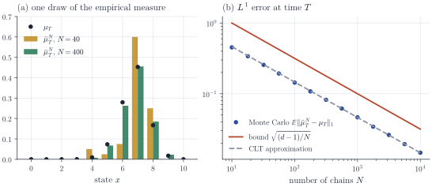
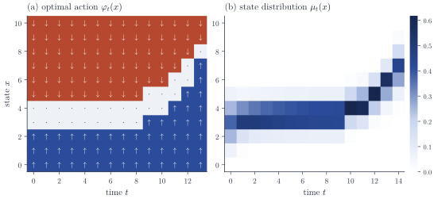
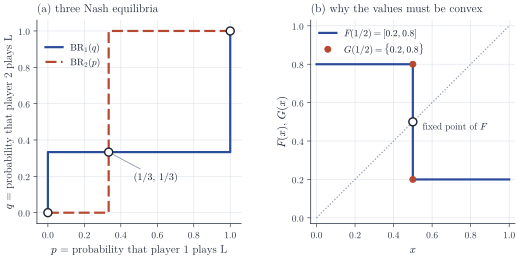

A mean-field game is solved in two steps. Fix the distribution of the population over time and solve the control problem of a single agent who takes that distribution as given, then require that the distribution generated when every agent uses the optimal control is the one that was fixed in the first place. The first step is dynamic programming, the second is a fixed point problem, and the object that links them is the law of a controlled Markov process. When the state space is finite and time is discrete, each of these ingredients reduces to elementary linear algebra and finite-dimensional topology, and apart from Brouwer's fixed point theorem and a few standard tools (Hoeffding's inequality, Carathéodory's theorem) every result needed is proved here.

This note collects those results. The two-step description is the one used by Lasry and Lions (2007) and, for static games with many players, in Chapter 1 of Carmona and Delarue (2018). Part 1 of the series uses them to set up discrete mean-field games, prove existence of equilibria, prove uniqueness under the Lasry–Lions monotonicity condition, and show that a mean-field equilibrium is an approximate Nash equilibrium of the game with $$N$$ players. The continuous-time counterparts (diffusions, the Hamilton–Jacobi–Bellman equation, the Fokker–Planck equation, fixed point theorems in infinite dimensions) come later, and the last section lists how each finite statement below reappears there.

## Notation

Throughout, $$\mathcal X$$ is a finite state space with $$d = \# \mathcal X$$ elements and $$\mathcal A$$ is a finite action space with $$k = \# \mathcal A$$ elements. Probability measures on $$\mathcal X$$ are written as row vectors $$\mu \in \Delta(\mathcal X) = \{\mu \in [0,1]^{\mathcal X} : \sum_x \mu(x) = 1\}$$ and real functions on $$\mathcal X$$ as column vectors $$u \in \R^{\mathcal X}$$, with pairing $$\langle \mu, u \rangle = \sum_x \mu(x) u(x)$$. A stochastic matrix $$P$$ on $$\mathcal X$$ has nonnegative entries and rows summing to one; it acts on measures from the right and on functions from the left,

$$
(\mu P)(y) = \sum_{x} \mu(x) P(x, y), \qquad (P u)(x) = \sum_{y} P(x, y) u(y),
$$

so that $$\langle \mu P, u \rangle = \langle \mu, P u \rangle$$. Signed measures are measured in the $$\ell^1$$ norm $$\norm{h}_1 = \sum_x \abs{h(x)}$$, which is twice the total variation distance when $$h$$ is a difference of two probability vectors, and functions in the sup norm $$\norm{u}_\infty$$. Then $$\abs{\langle \mu - \nu, u \rangle} \le \norm{\mu - \nu}_1 \norm{u}_\infty$$.

## Markov chains with time-dependent transitions

Let $$T \ge 1$$ be a horizon, $$\mu_0 \in \Delta(\mathcal X)$$, and $$P_0, \dots, P_{T-1}$$ stochastic matrices. A process $$X = (X_0, \dots, X_T)$$ on a probability space $$(\Omega, \mathcal F, \P)$$ is a Markov chain with initial law $$\mu_0$$ and transition matrices $$(P_t)$$ if

$$
\P(X_0 = x_0, X_1 = x_1, \dots, X_T = x_T) = \mu_0(x_0) \prod_{t=0}^{T-1} P_t(x_t, x_{t+1}) \qquad \text{for all } x_0, \dots, x_T \in \mathcal X .
$$

Equivalently, with $$\mathcal F_t = \sigma(X_0, \dots, X_t)$$, $$X_0 \sim \mu_0$$ and $$\P(X_{t+1} = y \mid \mathcal F_t) = P_t(X_t, y)$$ almost surely for each $$t < T$$ and $$y$$. Such a chain exists: take $$\Omega = \mathcal X^{T+1}$$ with the probability defined by the display. A construction on an arbitrary space is often more useful. Order $$\mathcal X = \{z_1, \dots, z_d\}$$ and set $$\Phi_t(x, v) = z_j$$ when $$\sum_{i < j} P_t(x, z_i) < v \le \sum_{i \le j} P_t(x, z_i)$$ for $$v \in (0, 1]$$. If $$X_0 \sim \mu_0$$ and $$U_1, \dots, U_T$$ are independent uniform variables on $$(0,1]$$, independent of $$X_0$$, then $$X_{t+1} = \Phi_t(X_t, U_{t+1})$$ is a Markov chain with transition matrices $$(P_t)$$. This representation puts many chains, independent or coupled, on one probability space, which is how the $$N$$-player games of Part 1 are built.

The law $$\mu_t$$ of $$X_t$$ evolves forward in time, while conditional expectations of future costs evolve backward. The two recursions are adjoint to each other.

**Proposition 1 (forward and backward equations).** Let $$X$$ be a Markov chain as above and $$\mu_t$$ the law of $$X_t$$.

1. $$\mu_{t+1} = \mu_t P_t$$ for $$t = 0, \dots, T-1$$.
2. Given functions $$c_0, \dots, c_{T-1}, g : \mathcal X \to \R$$, define $$u_T = g$$ and $$u_t = c_t + P_t u_{t+1}$$ for $$t = T-1, \dots, 0$$. Then $$M_t = \sum_{s<t} c_s(X_s) + u_t(X_t)$$ is an $$(\mathcal F_t)$$-martingale, and

   $$
   u_t(X_t) = \E\Bigl[\sum_{s=t}^{T-1} c_s(X_s) + g(X_T) \Bigm\vert \mathcal F_t\Bigr] \quad \text{almost surely.}
   $$

3. $$\E\bigl[\sum_{t<T} c_t(X_t) + g(X_T)\bigr] = \langle \mu_0, u_0 \rangle = \sum_{t<T} \langle \mu_t, c_t \rangle + \langle \mu_T, g \rangle$$.

*Proof.* (1) $$\mu_{t+1}(y) = \E\,\P(X_{t+1} = y \mid \mathcal F_t) = \E P_t(X_t, y) = \sum_x \mu_t(x) P_t(x, y)$$.

(2) By the Markov property, $$\E[u_{t+1}(X_{t+1}) \mid \mathcal F_t] = \sum_y P_t(X_t, y) u_{t+1}(y) = (P_t u_{t+1})(X_t) = u_t(X_t) - c_t(X_t)$$. Hence

$$
\E[M_{t+1} - M_t \mid \mathcal F_t] = c_t(X_t) + \E[u_{t+1}(X_{t+1}) \mid \mathcal F_t] - u_t(X_t) = 0 .
$$

All variables are bounded, so $$M$$ is a martingale and $$M_t = \E[M_T \mid \mathcal F_t]$$. Since $$M_T = \sum_{s<T} c_s(X_s) + g(X_T)$$, subtracting the $$\mathcal F_t$$-measurable sum $$\sum_{s<t} c_s(X_s)$$ gives the formula for $$u_t(X_t)$$.

(3) Take expectations in $$M_0 = \E[M_T \mid \mathcal F_0]$$ to get the first equality; the second is linearity, $$\E c_t(X_t) = \langle \mu_t, c_t \rangle$$.

Part (3) is a duality statement: the same number can be computed by pushing the initial law forward through the transition matrices or by pulling the costs backward. In the form $$\langle \mu_t, u_t \rangle - \langle \mu_{t+1}, u_{t+1} \rangle = \langle \mu_t, c_t \rangle$$, which follows from $$\langle \mu_{t+1}, u_{t+1} \rangle = \langle \mu_t, P_t u_{t+1} \rangle$$, it is the identity behind the Lasry–Lions uniqueness argument in Part 1. The martingale $$M$$ is the discrete form of Dynkin's formula.

The next estimates say how much the forward recursion can amplify a perturbation of the initial law or of the transition matrices. For a stochastic matrix $$P$$ let

$$
\delta(P) = \tfrac12 \max_{x, x' \in \mathcal X} \norm{P(x, \cdot) - P(x', \cdot)}_1 \in [0, 1],
$$

Dobrushin's ergodic coefficient (see also Levin and Peres, 2017, for contraction and mixing of Markov chains). It equals $$0$$ when all rows coincide (the next state forgets the current one) and $$1$$ when two rows have disjoint supports. For a policy $$\pi$$ that assigns to each state a distribution $$\pi(\cdot \mid x) \in \Delta(\mathcal A)$$ and a transition kernel $$p(y \mid x, a)$$, write $$P^{\pi}(x, y) = \sum_a \pi(a \mid x) p(y \mid x, a)$$.

**Proposition 2 (stability of the forward equation).** Let $$P, P'$$ be stochastic matrices and $$\mu, \nu \in \Delta(\mathcal X)$$.

1. $$\norm{\mu P - \nu P}_1 \le \delta(P) \norm{\mu - \nu}_1 \le \norm{\mu - \nu}_1$$.
2. $$\norm{\mu P - \mu P'}_1 \le \max_x \norm{P(x, \cdot) - P'(x, \cdot)}_1$$.
3. If $$\mu_{t+1} = \mu_t P_t$$ and $$\nu_{t+1} = \nu_t P'_t$$, then for every $$t \le T$$

   $$
   \norm{\mu_t - \nu_t}_1 \le \norm{\mu_0 - \nu_0}_1 + \sum_{s<t} \max_x \norm{P_s(x, \cdot) - P'_s(x, \cdot)}_1 .
   $$

4. For policies $$\pi, \pi'$$ and any kernel $$p$$, $$\max_x \norm{P^{\pi}(x, \cdot) - P^{\pi'}(x, \cdot)}_1 \le \max_x \norm{\pi(\cdot \mid x) - \pi'(\cdot \mid x)}_1$$.

*Proof.* (1) Let $$h = \mu - \nu \ne 0$$. Since $$\sum_x h(x) = 0$$, the positive and negative parts $$h^+$$ and $$h^-$$ have the same mass $$r = \tfrac12 \norm{h}_1 > 0$$, and $$\alpha = h^+/r$$, $$\beta = h^-/r$$ are probability vectors. Then

$$
h P = r(\alpha P - \beta P) = r \sum_{x, x'} \alpha(x) \beta(x') \bigl(P(x, \cdot) - P(x', \cdot)\bigr),
$$

and the triangle inequality gives $$\norm{hP}_1 \le r \cdot 2\delta(P) = \delta(P) \norm{h}_1$$.

(2) $$\norm{\mu(P - P')}_1 \le \sum_x \mu(x) \norm{P(x, \cdot) - P'(x, \cdot)}_1$$.

(3) Write $$\mu_{s+1} - \nu_{s+1} = (\mu_s - \nu_s) P_s + \nu_s (P_s - P'_s)$$, apply (1) with $$\delta(P_s) \le 1$$ and (2), and sum over $$s < t$$.

(4) $$P^{\pi}(x, \cdot) - P^{\pi'}(x, \cdot) = \sum_a \bigl(\pi(a \mid x) - \pi'(a \mid x)\bigr) p(\cdot \mid x, a)$$, and each $$p(\cdot \mid x, a)$$ has unit $$\ell^1$$ norm.

Parts (3) and (4) together say that, for a fixed initial law and fixed kernels $$p_t$$, the map from a time-dependent policy to the flow of state distributions it generates is Lipschitz, with constant at most $$T$$ when policies are compared through $$\max_{t, x} \norm{\pi_t(\cdot \mid x) - \pi'_t(\cdot \mid x)}_1$$. This is the continuity that the fixed point arguments of Part 1 require.

## Many independent chains

Let $$X^1, \dots, X^N$$ be independent copies of the chain above, with common initial law $$\mu_0$$ and transition matrices $$(P_t)$$, and let

$$
\bar\mu^N_t = \frac1N \sum_{i=1}^N \delta_{X^i_t}
$$

be their empirical measure at time $$t$$, a random element of $$\Delta(\mathcal X)$$. In a mean-field game this is the quantity each player reacts to. When the players interact only through their costs, start from independent states with law $$\mu_0$$, and all use the same Markov policy (defined in the next section) with independent randomization and transition noise, their states are independent copies of one chain, and the next result shows that $$\bar\mu^N_t$$ is then close to the deterministic flow $$\mu_t$$.

**Proposition 3 (law of large numbers for the empirical measure).** For each $$t \le T$$ and $$\varepsilon > 0$$,

$$
\E \norm{\bar\mu^N_t - \mu_t}_1 \le \sqrt{\frac{d - 1}{N}}, \qquad \P\bigl(\norm{\bar\mu^N_t - \mu_t}_1 \ge \varepsilon\bigr) \le 2^d e^{-N\varepsilon^2/2} .
$$

Consequently $$\P\bigl(\max_{t \le T} \norm{\bar\mu^N_t - \mu_t}_1 \ge \varepsilon\bigr) \le (T+1) 2^d e^{-N\varepsilon^2/2}$$.

*Proof.* For fixed $$x$$, $$N \bar\mu^N_t(x)$$ is binomial with parameters $$N$$ and $$\mu_t(x)$$, so by Jensen's inequality $$\E\abs{\bar\mu^N_t(x) - \mu_t(x)} \le \sqrt{\mu_t(x)(1 - \mu_t(x))/N}$$. Summing over $$x$$ and applying the Cauchy–Schwarz inequality twice,

$$
\sum_x \sqrt{\mu_t(x)(1 - \mu_t(x))} \le \sqrt{d \Bigl(1 - \sum_x \mu_t(x)^2\Bigr)} \le \sqrt{d (1 - 1/d)} = \sqrt{d - 1},
$$

where $$\sum_x \mu_t(x)^2 \ge 1/d$$ because $$1 = (\sum_x \mu_t(x))^2 \le d \sum_x \mu_t(x)^2$$.

For the tail bound, note that a signed vector $$h$$ with $$\sum_x h(x) = 0$$ satisfies $$\norm{h}_1 = 2 \max_{S \subseteq \mathcal X} h(S)$$, the maximum being attained at $$S = \{h > 0\}$$. Hence

$$
\bigl\{\norm{\bar\mu^N_t - \mu_t}_1 \ge \varepsilon\bigr\} \subseteq \bigcup_{S \subseteq \mathcal X} \bigl\{\bar\mu^N_t(S) - \mu_t(S) \ge \varepsilon/2\bigr\}.
$$

For each $$S$$, $$\bar\mu^N_t(S)$$ is the average of $$N$$ independent Bernoulli variables with mean $$\mu_t(S)$$, and Hoeffding's inequality (Hoeffding, 1963) bounds the probability of each event by $$\exp(-2N(\varepsilon/2)^2) = e^{-N\varepsilon^2/2}$$. A union bound over the subsets (the events for $$S = \emptyset$$ and $$S = \mathcal X$$ are empty, so $$2^d$$ is generous), and then over the $$T+1$$ times, completes the proof.

Unless $$\mu_t$$ is a point mass, the rate $$N^{-1/2}$$ is the correct order. By the central limit theorem, and because $$\sqrt N(\bar\mu^N_t(x) - \mu_t(x))$$ has bounded second moments and is therefore uniformly integrable, $$\sqrt N\, \E\abs{\bar\mu^N_t(x) - \mu_t(x)} \to \sqrt{2/\pi}\, \sqrt{\mu_t(x)(1-\mu_t(x))}$$, so $$\sqrt N\, \E \norm{\bar\mu^N_t - \mu_t}_1$$ converges to $$\sqrt{2/\pi} \sum_x \sqrt{\mu_t(x)(1 - \mu_t(x))}$$. Figure 1 compares this limit and the bound of Proposition 3 with a simulation. The constant in the mean bound grows like $$\sqrt d$$, and the factor $$2^d$$ in the tail bound can be removed: $$\norm{\bar\mu^N_t - \mu_t}_1$$ is a function of $$N$$ independent variables that changes by at most $$2/N$$ when one of them changes, so McDiarmid's bounded-difference inequality gives $$\P(\norm{\bar\mu^N_t - \mu_t}_1 \ge \sqrt{(d-1)/N} + s) \le e^{-Ns^2/2}$$ for $$s > 0$$. On a continuous state space the $$\ell^1$$ distance itself becomes useless: if $$\mu$$ has no atoms, $$\bar\mu^N$$ charges a finite set of $$\mu$$-measure zero, so $$\norm{\bar\mu^N - \mu}_1 = 2$$ for every $$N$$. It is replaced by a Wasserstein distance, for which the rate on $$\R^q$$ is of order $$N^{-1/q}$$ when $$q \ge 3$$ (Fournier and Guillin, 2015).

<figure>
  
  <figcaption>Figure 1. Independent copies of the controlled chain of Figure 2 below, run under its optimal policy ($d = 11$ states, $T = 14$). Since only the time-$T$ marginal matters, $N\bar\mu^N_T$ is drawn directly from its multinomial law. (a) The law $\mu_T$ (dots) and one draw of the empirical measure $\bar\mu^N_T$ for $N = 40$ and $N = 400$. (b) Monte Carlo estimates of $\mathbb E\lVert\bar\mu^N_T - \mu_T\rVert_1$ (4,000 replications per $N$), the bound $\sqrt{(d-1)/N}$ of Proposition 3, and the central-limit approximation $\sqrt{2/\pi}\sum_x \sqrt{\mu_T(x)(1-\mu_T(x))}/\sqrt N$.</figcaption>
</figure>

Two remarks prepare the $$N$$-player analysis. First, a player who reacts to the empirical measure of the *other* players sees $$\bar\mu^{N,-i}_t = (N-1)^{-1} \sum_{j \ne i} \delta_{X^j_t}$$, and

$$
\bar\mu^N_t - \bar\mu^{N,-i}_t = \frac1N \bigl(\delta_{X^i_t} - \bar\mu^{N,-i}_t\bigr), \qquad \text{so} \qquad \norm{\bar\mu^N_t - \bar\mu^{N,-i}_t}_1 \le \frac2N .
$$

At each time, with the other players' states held fixed, a single player therefore moves the empirical measure by at most $$2/N$$, whatever she does. (When the transitions depend on the empirical measure, her deviation also changes the future laws of the others; that effect is of the same order but needs a separate argument.) Second, independence is essential in Proposition 3. If the transition matrices themselves depend on $$\bar\mu^N_t$$, the chains interact and are no longer independent; the replacement for Proposition 3 is propagation of chaos, which is the subject of a later part.

## Finite-horizon Markov decision processes

A Markov decision process on $$\mathcal X$$ with actions in $$\mathcal A$$ and horizon $$T$$ is given by transition kernels $$p_t(\cdot \mid x, a) \in \Delta(\mathcal X)$$, running costs $$c_t : \mathcal X \times \mathcal A \to \R$$ for $$t < T$$, and a terminal cost $$g : \mathcal X \to \R$$. The decision maker may use the whole history $$h_t = (x_0, a_0, x_1, a_1, \dots, x_t)$$ and may randomize. A history-dependent randomized policy is a family $$\pi = (\pi_t)_{t<T}$$ of maps $$h_t \mapsto \pi_t(\cdot \mid h_t) \in \Delta(\mathcal A)$$; it is Markov if $$\pi_t(\cdot \mid h_t)$$ depends on $$h_t$$ only through $$x_t$$, in which case we write $$\pi_t(a \mid x)$$, and Markov deterministic if moreover $$\pi_t(\cdot \mid x) = \delta_{\varphi_t(x)}$$ for maps $$\varphi_t : \mathcal X \to \mathcal A$$. A policy $$\pi$$ and an initial law $$m_0$$ determine a law $$\P^{\pi}_{m_0}$$ on state–action paths,

$$
\P^{\pi}_{m_0}(X_0 = x_0, A_0 = a_0, \dots, A_{T-1} = a_{T-1}, X_T = x_T) = m_0(x_0) \prod_{t=0}^{T-1} \pi_t(a_t \mid h_t)\, p_t(x_{t+1} \mid x_t, a_t),
$$

and a cost

$$
J(\pi; m_0) = \E^{\pi}_{m_0}\Bigl[\sum_{t=0}^{T-1} c_t(X_t, A_t) + g(X_T)\Bigr].
$$

Write $$H_t = (X_0, A_0, \dots, X_t)$$ and $$\mathcal G_t = \sigma(H_t, A_t)$$. The path law gives directly $$\P^{\pi}_{m_0}(A_t = a \mid H_t) = \pi_t(a \mid H_t)$$ and $$\P^{\pi}_{m_0}(X_{t+1} = y \mid \mathcal G_t) = p_t(y \mid X_t, A_t)$$.

The Bellman recursion defines the value function $$V$$ and the state–action value function $$Q$$:

$$
V_T = g, \qquad Q_t(x, a) = c_t(x, a) + \sum_{y} p_t(y \mid x, a) V_{t+1}(y), \qquad V_t(x) = \min_{a \in \mathcal A} Q_t(x, a),
$$

for $$t = T-1, \dots, 0$$. Let $$\mathcal A^*_t(x) = \argmin_{a} Q_t(x, a)$$, a nonempty set because $$\mathcal A$$ is finite.

**Theorem 4 (dynamic programming).**

1. For every history-dependent randomized policy $$\pi$$ and every $$m_0 \in \Delta(\mathcal X)$$, $$J(\pi; m_0) \ge \langle m_0, V_0 \rangle$$, with equality if and only if $$\P^{\pi}_{m_0}\bigl(A_t \in \mathcal A^*_t(X_t)\bigr) = 1$$ for every $$t < T$$.
2. Every Markov deterministic policy with $$\varphi_t(x) \in \mathcal A^*_t(x)$$ for all $$t, x$$ satisfies $$J(\varphi; m_0) = \langle m_0, V_0 \rangle$$ for all $$m_0$$.

In particular $$\min_\pi J(\pi; m_0) = \langle m_0, V_0 \rangle$$, the minimum over all history-dependent randomized policies is attained by a Markov deterministic one, and $$V_0(x)$$ is the optimal cost from the initial state $$x$$.

*Proof.* Let $$M_t = \sum_{s<t} c_s(X_s, A_s) + V_t(X_t)$$ for $$t = 0, \dots, T$$. Using the conditional law of $$X_{t+1}$$ given $$\mathcal G_t$$,

$$
\begin{aligned}
D_t := \E^{\pi}_{m_0}[M_{t+1} - M_t \mid \mathcal G_t] &= c_t(X_t, A_t) + \sum_y p_t(y \mid X_t, A_t) V_{t+1}(y) - V_t(X_t) \\
&= Q_t(X_t, A_t) - V_t(X_t) \ge 0 .
\end{aligned}
$$

Since $$M_T$$ is the total cost and $$\E M_0 = \langle m_0, V_0 \rangle$$,

$$
J(\pi; m_0) - \langle m_0, V_0 \rangle = \E^{\pi}_{m_0}[M_T - M_0] = \sum_{t<T} \E^{\pi}_{m_0} D_t \ge 0,
$$

with equality if and only if $$D_t = 0$$ almost surely for each $$t$$, that is, $$A_t \in \mathcal A^*_t(X_t)$$ almost surely. Under $$\varphi$$ in (2), $$A_t = \varphi_t(X_t) \in \mathcal A^*_t(X_t)$$ surely.

Theorem 4 is the finite-horizon dynamic programming theorem; Puterman (1994) gives the general treatment. Neither history nor randomization lowers the optimal cost of a single decision maker. They are kept anyway, for two reasons. Randomization convexifies the problem, and convexity is what the fixed point theorems below require; in games, deterministic strategies can fail to admit any equilibrium. (The convex objects turn out to be occupation measures rather than policies, as explained after Proposition 6.) And in the $$N$$-player games of Part 1, an equilibrium must be robust to deviations to arbitrary policies, so the comparison class has to be large.

For a Markov policy $$\pi$$ let $$\mu^{\pi}_t$$ be the law of $$X_t$$ under $$\P^{\pi}_{m_0}$$ and

$$
\rho^{\pi}_t(x, a) = \P^{\pi}_{m_0}(X_t = x, A_t = a) = \mu^{\pi}_t(x)\, \pi_t(a \mid x),
$$

its occupation measure at time $$t$$. By Proposition 1(1), $$\mu^{\pi}_{t+1} = \mu^{\pi}_t P^{\pi_t}_t$$ with $$P^{\pi_t}_t(x, y) = \sum_a \pi_t(a \mid x) p_t(y \mid x, a)$$. The policy evaluation recursion $$V^{\pi}_T = g$$, $$Q^{\pi}_t = c_t + p_t V^{\pi}_{t+1}$$, $$V^{\pi}_t(x) = \sum_a \pi_t(a \mid x) Q^{\pi}_t(x, a)$$, where $$(p_t v)(x, a) = \sum_y p_t(y \mid x, a) v(y)$$, gives $$J(\pi; m_0) = \langle m_0, V^{\pi}_0 \rangle$$. Indeed, summing the path law over the actions shows that under $$\P^{\pi}_{m_0}$$ the state process alone is a Markov chain with transition matrices $$P^{\pi_t}_t$$; conditioning on $$H_t$$ gives $$\E c_t(X_t, A_t) = \E c^{\pi}_t(X_t)$$ with $$c^{\pi}_t(x) = \sum_a \pi_t(a \mid x) c_t(x, a)$$; and $$V^{\pi}_t = c^{\pi}_t + P^{\pi_t}_t V^{\pi}_{t+1}$$, so Proposition 1(3) applies. The computation in the proof of Theorem 4 then compares any two policies.

**Proposition 5 (performance difference).** For Markov policies $$\pi, \pi'$$ and $$m_0 \in \Delta(\mathcal X)$$,

$$
J(\pi; m_0) - J(\pi'; m_0) = \sum_{t<T} \sum_{x, a} \rho^{\pi}_t(x, a) \bigl(Q^{\pi'}_t(x, a) - V^{\pi'}_t(x)\bigr).
$$

Taking for $$\pi'$$ the policy $$\varphi$$ of Theorem 4(2), $$J(\pi; m_0) - \langle m_0, V_0 \rangle = \sum_{t, x, a} \rho^{\pi}_t(x, a) (Q_t(x, a) - V_t(x))$$, and therefore $$\pi$$ is optimal for $$m_0$$ if and only if $$\pi_t(\cdot \mid x)$$ is supported in $$\mathcal A^*_t(x)$$ for every $$t$$ and every $$x$$ with $$\mu^{\pi}_t(x) > 0$$.

*Proof.* Repeat the proof of Theorem 4 under $$\P^{\pi}_{m_0}$$ with $$M_t = \sum_{s<t} c_s(X_s, A_s) + V^{\pi'}_t(X_t)$$: now $$\E[M_{t+1} - M_t \mid \mathcal G_t] = Q^{\pi'}_t(X_t, A_t) - V^{\pi'}_t(X_t)$$, whose expectation is $$\sum_{x,a} \rho^{\pi}_t(x,a)(Q^{\pi'}_t(x,a) - V^{\pi'}_t(x))$$, and $$\E M_0 = \langle m_0, V^{\pi'}_0 \rangle = J(\pi'; m_0)$$. For $$\pi' = \varphi$$, backward induction gives $$V^{\varphi} = V$$ and $$Q^{\varphi} = Q$$: both equal $$g$$ at time $$T$$, and if $$V^{\varphi}_{t+1} = V_{t+1}$$ then $$Q^{\varphi}_t = Q_t$$ and $$V^{\varphi}_t(x) = Q_t(x, \varphi_t(x)) = V_t(x)$$. Every summand $$\rho^{\pi}_t(x,a)(Q_t(x,a) - V_t(x))$$ is nonnegative, so the sum vanishes exactly when $$\pi_t(a \mid x) = 0$$ whenever $$\mu^{\pi}_t(x) > 0$$ and $$a \notin \mathcal A^*_t(x)$$.

The quantity $$Q_t - V_t \ge 0$$ is the advantage, with the sign convention of costs, and Proposition 5 is the finite-horizon form of the performance difference lemma of Kakade and Langford. The characterization of optimality is the form in which best responses enter Part 1: a best response to a given population flow is any Markov policy whose occupation measure charges only minimizing actions at reachable states. The set of such occupation measures is convex, as the next proposition and the remark after it show.

**Proposition 6 (occupation measures).** Let $$\mathcal R(m_0)$$ be the set of $$\rho = (\rho_0, \dots, \rho_{T-1})$$ with $$\rho_t \in [0, \infty)^{\mathcal X \times \mathcal A}$$ such that

$$
\sum_a \rho_0(x, a) = m_0(x), \qquad \sum_a \rho_{t+1}(y, a) = \sum_{x, a} \rho_t(x, a) p_t(y \mid x, a) \quad (0 \le t \le T-2)
$$

for all $$x, y$$.

1. $$\rho^{\pi} \in \mathcal R(m_0)$$ for every Markov policy $$\pi$$.
2. Every $$\rho \in \mathcal R(m_0)$$ equals $$\rho^{\pi}$$ for the Markov policy $$\pi_t(a \mid x) = \rho_t(x, a) / \sum_b \rho_t(x, b)$$ when the denominator is positive and $$\pi_t(\cdot \mid x)$$ arbitrary otherwise.
3. $$\mathcal R(m_0)$$ is a nonempty compact convex polytope, and $$J(\pi; m_0) = L(\rho^{\pi})$$ for the linear functional

   $$
   L(\rho) = \sum_{t<T} \sum_{x,a} \rho_t(x, a) c_t(x, a) + \sum_{x, a, y} \rho_{T-1}(x, a) p_{T-1}(y \mid x, a) g(y).
   $$

Hence $$\min_\pi J(\pi; m_0) = \min_{\rho \in \mathcal R(m_0)} L(\rho)$$, a linear program.

*Proof.* (1) $$\sum_a \rho^{\pi}_t(x, a) = \mu^{\pi}_t(x)$$, and the forward equation $$\mu^{\pi}_{t+1}(y) = \sum_{x, a} \mu^{\pi}_t(x) \pi_t(a \mid x) p_t(y \mid x, a)$$ is the constraint.

(2) Let $$m_t(x) = \sum_a \rho_t(x, a)$$. We show $$\mu^{\pi}_t = m_t$$ by induction; the case $$t = 0$$ is the first constraint. If $$\mu^{\pi}_t = m_t$$, then $$\rho^{\pi}_t(x, a) = m_t(x) \pi_t(a \mid x) = \rho_t(x, a)$$: by the definition of $$\pi_t$$ when $$m_t(x) > 0$$, and because both sides vanish when $$m_t(x) = 0$$ (a nonnegative vector with zero sum is zero). Then $$\mu^{\pi}_{t+1}(y) = \sum_{x,a} \rho_t(x,a) p_t(y \mid x,a) = m_{t+1}(y)$$ by the second constraint.

(3) $$\mathcal R(m_0)$$ is nonempty by (1) and is the intersection of finitely many closed half-spaces and hyperplanes, hence a closed convex polyhedron. Summing the second constraint over $$y$$ shows that every $$\rho_t$$ has total mass $$1$$, so $$\mathcal R(m_0)$$ is bounded. Finally $$J(\pi; m_0) = \sum_t \E c_t(X_t, A_t) + \E g(X_T)$$ with $$\E c_t(X_t,A_t) = \langle \rho^{\pi}_t, c_t \rangle$$ and $$\P(X_T = y) = \sum_{x,a} \rho^{\pi}_{T-1}(x,a) p_{T-1}(y \mid x,a)$$.

By Propositions 5 and 6(2), the occupation measures of optimal Markov policies form the set

$$
\mathcal R^*(m_0) = \bigl\{\rho \in \mathcal R(m_0) : \rho_t(x, a) = 0 \text{ whenever } a \notin \mathcal A^*_t(x)\bigr\} = \argmin_{\rho \in \mathcal R(m_0)} L(\rho),
$$

a face of the polytope $$\mathcal R(m_0)$$, hence nonempty, compact and convex. The set of optimal *policies* need not be convex. Take $$T = 2$$, $$m_0 = \delta_0$$, and let the action $$a$$ (resp. $$b$$) move state $$0$$ to state $$1$$ (resp. $$2$$) at no cost; at time $$1$$ action $$a$$ costs $$0$$ and action $$b$$ costs $$1$$ in every state, and $$g = 0$$. The policy that plays $$a$$, then $$a$$ in state $$1$$ and $$b$$ in state $$2$$, and the policy that plays $$b$$, then $$a$$ in state $$2$$ and $$b$$ in state $$1$$, both cost $$0$$, because each misbehaves only in a state it never reaches; their average plays $$b$$ with probability $$1/2$$ at time $$1$$ and costs $$1/2$$. Mixing policies does not mix their occupation measures, which is why the fixed point arguments of Part 1 work with $$\rho$$ rather than with $$\pi$$.

The dual of this linear program recovers the Bellman equation. With $$v_T = g$$ fixed, the dual problem is to maximize $$\langle m_0, v_0 \rangle$$ over $$v_0, \dots, v_{T-1} \in \R^{\mathcal X}$$ subject to $$v_t(x) \le c_t(x, a) + \sum_y p_t(y \mid x, a) v_{t+1}(y)$$ for all $$t, x, a$$. Any feasible $$v$$ satisfies $$v_t \le V_t$$, by backward induction ($$v_t(x) \le \min_a [c_t(x,a) + (p_t v_{t+1})(x,a)] \le \min_a Q_t(x,a)$$ when $$v_{t+1} \le V_{t+1}$$), and $$V$$ itself is feasible. So the dual value is $$\langle m_0, V_0 \rangle$$, equal to the primal value by Theorem 4, and the value function is a dual optimal solution. The same primal–dual pair, with occupation measures of a controlled diffusion in place of $$\rho$$ and subsolutions of the HJB equation in place of $$v$$, is the linear programming approach to stochastic control taken up later in the series. For finite models the linear programming formulation goes back to Manne (1960); Altman's monograph develops it for constrained problems.

Figure 2 shows the two recursions on a small example. The states $$\{0, \dots, 10\}$$ lie on a line; the actions are $$-1, 0, +1$$; an action moves the state by $$a$$ with probability $$0.7$$ and by $$a \pm 1$$ with probability $$0.15$$ each, truncated at the boundary. The running cost $$c_t(x, a) = 0.5\abs{a} + 0.15 (x - 3)^2$$ pulls the state toward $$3$$, the terminal cost $$g(x) = (x - 8)^2$$ toward $$8$$, and $$T = 14$$. The optimal policy, computed backward, holds the state in $$\{3, 4\}$$ up to time $$8$$ and moves it up toward $$8$$ during the last five steps; the forward recursion transports the initial law along that policy, and the noise together with the running cost leaves the final law centred near $$7$$.

<figure>
  
  <figcaption>Figure 2. The example MDP. (a) The optimal action $\varphi_t(x)$ from backward induction: up ($+1$, blue), stay ($0$, light) or down ($-1$, red). The minimizer is unique at every $(t, x)$. (b) The law $\mu_t$ of $X_t$ under $\varphi$, from the forward recursion started at $m_0 = $ Binomial$(4, 1/2)$ shifted to $\{1, \dots, 5\}$. The optimal cost is $\langle m_0, V_0\rangle = 8.325$, which agrees with $\sum_t\langle\mu_t, c_t(\cdot,\varphi_t(\cdot))\rangle + \langle\mu_T, g\rangle$ as Proposition 1(3) requires.</figcaption>
</figure>

### Entropy regularization

Best responses in Theorem 4 can be non-unique, and the set $$\mathcal A^*_t(x)$$ can jump when the costs change slightly. Penalizing randomization by relative entropy removes both problems. Let $$\eta$$ be the uniform distribution on $$\mathcal A$$, $$\tau > 0$$, and

$$
J_\tau(\pi; m_0) = \E^{\pi}_{m_0}\Bigl[\sum_{t<T} \bigl(c_t(X_t, A_t) + \tau \KL(\pi_t(\cdot \mid H_t) \,\Vert\, \eta)\bigr) + g(X_T)\Bigr],
$$

where $$\KL(q \,\Vert\, \eta) = \sum_a q(a) \log(q(a)/\eta(a)) \in [0, \log k]$$. Define $$V^\tau_T = g$$ and, backward in time,

$$
Q^\tau_t(x, a) = c_t(x, a) + \sum_y p_t(y \mid x, a) V^\tau_{t+1}(y), \qquad V^\tau_t(x) = -\tau \log \sum_a \eta(a) e^{-Q^\tau_t(x, a)/\tau},
$$

and the Gibbs policy $$\pi^\tau_t(a \mid x) = \eta(a) \exp\bigl(-(Q^\tau_t(x, a) - V^\tau_t(x))/\tau\bigr)$$. The proof rests on the Gibbs variational identity: for $$\xi \in \R^{\mathcal A}$$, $$Z = \sum_a \eta(a) e^{-\xi(a)/\tau}$$, $$q^*(a) = \eta(a) e^{-\xi(a)/\tau}/Z$$ and any $$q \in \Delta(\mathcal A)$$,

$$
\sum_a q(a) \xi(a) + \tau \KL(q \,\Vert\, \eta) = -\tau \log Z + \tau \KL(q \,\Vert\, q^*),
$$

which follows by writing $$\log(q/\eta) = \log(q/q^*) - \xi/\tau - \log Z$$. Since $$\KL(q \,\Vert\, q^*) \ge 0$$ with equality only at $$q = q^*$$, the left side is minimized uniquely at $$q^*$$, with minimum $$-\tau \log Z$$.

**Proposition 7 (entropy-regularized dynamic programming).** For every history-dependent randomized policy $$\pi$$, $$J_\tau(\pi; m_0) \ge \langle m_0, V^\tau_0 \rangle$$, with equality if and only if $$\pi_t(\cdot \mid H_t) = \pi^\tau_t(\cdot \mid X_t)$$ almost surely for every $$t$$. Moreover

$$
V_t(x) \le V^\tau_t(x) \le V_t(x) + \tau (T - t) \log k \qquad \text{for all } t, x,
$$

and $$\pi^\tau$$ depends continuously on $$(c, p, g)$$. In particular $$J(\pi^\tau; m_0) \le \min_\pi J(\pi; m_0) + \tau T \log k$$.

*Proof.* Let $$M_t = \sum_{s<t} \bigl(c_s(X_s, A_s) + \tau \KL(\pi_s(\cdot \mid H_s) \,\Vert\, \eta)\bigr) + V^\tau_t(X_t)$$. Conditioning first on $$\mathcal G_t$$ and then on $$H_t$$,

$$
\begin{aligned}
\E[M_{t+1} - M_t \mid H_t] &= \sum_a \pi_t(a \mid H_t) Q^\tau_t(X_t, a) + \tau \KL(\pi_t(\cdot \mid H_t) \,\Vert\, \eta) - V^\tau_t(X_t) \\
&= \tau \KL\bigl(\pi_t(\cdot \mid H_t) \,\Vert\, \pi^\tau_t(\cdot \mid X_t)\bigr)
\end{aligned}
$$

by the Gibbs identity with $$\xi = Q^\tau_t(X_t, \cdot)$$. Summing expectations as in Theorem 4 gives the inequality and the equality case.

For the bounds, write $$\mathrm{smin}_\tau(\xi) = -\tau \log \sum_a \eta(a) e^{-\xi(a)/\tau}$$. Keeping only the term of a minimizer $$a^*$$ in the sum gives $$\mathrm{smin}_\tau(\xi) \le \min_a \xi(a) + \tau \log k$$, and bounding every term by $$e^{-\min \xi/\tau}$$ gives $$\mathrm{smin}_\tau(\xi) \ge \min_a \xi(a)$$. Both are monotone in $$\xi$$. Assuming the bounds at time $$t+1$$, we get $$Q_t \le Q^\tau_t \le Q_t + \tau(T-t-1)\log k$$ entrywise, and applying $$\mathrm{smin}_\tau$$ yields them at time $$t$$; at $$t = T$$ they hold with equality. Continuity holds because $$\pi^\tau$$ is obtained from $$(c, p, g)$$ by finitely many sums, products, exponentials and logarithms of positive numbers. Finally, $$J \le J_\tau$$ because the entropy term is nonnegative, so $$J(\pi^\tau; m_0) \le J_\tau(\pi^\tau; m_0) = \langle m_0, V^\tau_0 \rangle \le \langle m_0, V_0 \rangle + \tau T \log k$$.

In Part 1, entropy regularization makes the best response single-valued and continuous in the population flow, so that Brouwer's theorem suffices for existence. The last bound then says that a regularized equilibrium is an approximate equilibrium of the unregularized game, each agent being within $$\tau T \log k$$ of her best cost; it says nothing about the distance between equilibria, and limits as $$\tau \to 0$$ have to be identified separately. The same soft Bellman recursion underlies soft $$Q$$-learning and the softmax policies of reinforcement learning; Geist, Scherrer and Pietquin (2019) treat regularized MDPs systematically.

## Fixed points

### Contractions

**Theorem 8 (Banach).** Let $$(\mathcal M, \varrho)$$ be a nonempty complete metric space and $$\Gamma : \mathcal M \to \mathcal M$$ satisfy $$\varrho(\Gamma x, \Gamma y) \le \lambda \varrho(x, y)$$ for some $$\lambda < 1$$. Then $$\Gamma$$ has a unique fixed point $$x^*$$, and $$\varrho(\Gamma^n x, x^*) \le \lambda^n (1 - \lambda)^{-1} \varrho(\Gamma x, x)$$ for every $$x$$ and $$n \ge 0$$.

*Proof.* $$\varrho(\Gamma^{n+1} x, \Gamma^n x) \le \lambda^n \varrho(\Gamma x, x)$$, so for $$j > n$$ the triangle inequality gives $$\varrho(\Gamma^j x, \Gamma^n x) \le \sum_{i=n}^{j-1} \lambda^i \varrho(\Gamma x, x) \le \lambda^n (1-\lambda)^{-1} \varrho(\Gamma x, x)$$. The sequence $$(\Gamma^n x)$$ is Cauchy and converges to some $$x^*$$; $$\Gamma$$ is continuous, so $$\Gamma x^* = x^*$$. Letting $$j \to \infty$$ in the last bound gives the rate. Two fixed points $$x^*, y^*$$ satisfy $$\varrho(x^*, y^*) \le \lambda \varrho(x^*, y^*)$$, hence coincide.

Combined with Proposition 2(1), Banach's theorem gives the standard convergence result for chains: if $$\delta(P) < 1$$, the map $$\mu \mapsto \mu P$$ is a $$\delta(P)$$-contraction of the complete metric space $$(\Delta(\mathcal X), \norm{\cdot}_1)$$, so $$P$$ has a unique stationary distribution $$\mu^\star$$, and iterating Proposition 2(1) directly gives $$\norm{\mu P^n - \mu^\star}_1 \le \delta(P)^n \norm{\mu - \mu^\star}_1 \le 2 \delta(P)^n$$ for every initial $$\mu$$. Among the fixed point theorems in this note, only Banach's is constructive and gives uniqueness. In a mean-field game it applies when the map that sends a population flow to the flow generated by the best response to it is a contraction. This requires a single-valued, Lipschitz best response, which entropy regularization provides, and a dependence on the population that is weak compared with the Lipschitz constant $$T$$ of Proposition 2. In general the equilibrium map is not a contraction, and the remaining theorems give existence only.

### Brouwer's theorem

**Theorem 9 (Brouwer).** Let $$K \subset \R^q$$ be nonempty, compact and convex, and $$f : K \to K$$ continuous. Then $$f$$ has a fixed point.

Short analytic proofs are given by Milnor (1978); a combinatorial proof through Sperner's lemma is in Border (1985). Both are usually written for the closed unit ball or the simplex, and the general case reduces to these. Let $$B$$ be a closed ball (or a simplex) containing $$K$$ and $$\Pi_K$$ the Euclidean projection onto $$K$$, which is well defined and $$1$$-Lipschitz because $$K$$ is nonempty, closed and convex. Then $$f \circ \Pi_K$$ maps $$B$$ continuously into $$K \subseteq B$$, so it has a fixed point $$z$$. As $$z = f(\Pi_K z) \in K$$, we have $$\Pi_K z = z$$, and therefore $$f(z) = z$$.

Each hypothesis is needed. The translation $$x \mapsto x + 1$$ of $$\R$$ (not compact), a rotation of the unit circle by an angle that is not a multiple of $$2\pi$$ (compact but not convex), and the map of $$[0, 1]$$ equal to $$1$$ on $$[0, 1/2]$$ and $$0$$ elsewhere (not continuous) have no fixed points. The proofs are non-constructive. Approximate fixed points, in the sense of a point $$x$$ with $$\abs{f(x) - x} \le \varepsilon$$, can be located by searching a fine grid or by simplicial algorithms, but for Lipschitz maps every method that only evaluates $$f$$ needs, in the worst case, a number of evaluations that grows exponentially (Hirsch, Papadimitriou and Vavasis, 1989). A small residual also does not mean that $$x$$ is close to a true fixed point. This is one reason why the learning dynamics studied for mean-field games rely on additional structure, such as monotonicity, rather than on existence alone.

### Correspondences and Kakutani's theorem

A best response is a set, not a point, and its size can jump: in Figure 3(a), a player is indifferent between her two actions exactly when the opponent plays L with probability $$1/3$$, and the best response jumps from one pure action to the other there. Fixed point theorems for set-valued maps handle this. A correspondence $$F : K \rightrightarrows K$$ assigns to each $$x \in K$$ a nonempty set $$F(x) \subseteq K$$, and it has a closed graph if $$\{(x, y) \in K \times K : y \in F(x)\}$$ is closed. For correspondences with values in a compact set, a closed graph is equivalent to upper hemicontinuity with closed values (Aliprantis and Border, 2006); we use only the closed-graph formulation.

**Theorem 10 (Kakutani, 1941).** Let $$K \subset \R^q$$ be nonempty, compact and convex, and let $$F : K \rightrightarrows K$$ have nonempty convex values and a closed graph. Then there is $$x^* \in K$$ with $$x^* \in F(x^*)$$.

*Proof.* Fix $$\varepsilon > 0$$. By compactness there are $$x_1, \dots, x_r \in K$$ with $$K \subseteq \bigcup_i B(x_i, \varepsilon)$$, the open balls of radius $$\varepsilon$$. Choose $$y_i \in F(x_i)$$ and set $$\psi_i(x) = \max(0, \varepsilon - \abs{x - x_i})$$, $$\chi_i = \psi_i / \sum_j \psi_j$$; the denominator is positive on $$K$$, so the $$\chi_i$$ are continuous, nonnegative and sum to one. The map $$f_\varepsilon(x) = \sum_i \chi_i(x) y_i$$ is continuous and takes values in $$K$$ because $$K$$ is convex. By Theorem 9 it has a fixed point $$x_\varepsilon$$.

Since $$\chi_i(x_\varepsilon) > 0$$ only if $$\abs{x_\varepsilon - x_i} < \varepsilon$$, the point $$x_\varepsilon$$ lies in the convex hull of $$\{y_i : \abs{x_i - x_\varepsilon} < \varepsilon\}$$. By Carathéodory's theorem (Rockafellar, 1970, Section 17) it is a convex combination of at most $$q + 1$$ of these points:

$$
x_\varepsilon = \sum_{j=0}^{q} w^\varepsilon_j y^\varepsilon_j, \qquad y^\varepsilon_j \in F(x^\varepsilon_j), \quad \abs{x^\varepsilon_j - x_\varepsilon} < \varepsilon, \quad w^\varepsilon \in \Delta_{q+1},
$$

where $$\Delta_{q+1}$$ is the probability simplex in $$\R^{q+1}$$ (repeating points if fewer than $$q + 1$$ are needed). Let $$\varepsilon \to 0$$ along a sequence. By compactness of $$K$$ and $$\Delta_{q+1}$$ we may pass to a subsequence along which $$x_\varepsilon \to x^*$$, $$w^\varepsilon \to w$$ and $$y^\varepsilon_j \to y_j$$ for each $$j$$. Then $$x^\varepsilon_j \to x^*$$ as well, and the closed graph gives $$y_j \in F(x^*)$$. Passing to the limit, $$x^* = \sum_j w_j y_j$$, which belongs to $$F(x^*)$$ because $$F(x^*)$$ is convex.

The convexity of $$K$$ is used to keep $$f_\varepsilon$$ inside $$K$$, the closed graph to identify the limits $$y_j$$, and the convexity of $$F(x^*)$$ in the last step. Figure 3(b) shows why the last hypothesis cannot be dropped: the correspondence $$G$$ has a closed graph, but at the one point where it would have to cross the diagonal its value is $$\{0.2, 0.8\}$$ instead of the segment between them, and it has no fixed point.

### Best responses: Berge's maximum theorem

Kakutani's theorem is applied to best-response correspondences, and their closed graph comes from the following result (Aliprantis and Border, 2006, give the general version for compact-valued continuous constraint correspondences).

**Proposition 11 (Berge's maximum theorem, compact case).** Let $$K \subseteq \R^{q_1}$$, let $$Y \subset \R^{q_2}$$ be nonempty and compact, and let $$f : K \times Y \to \R$$ be continuous. Then $$v(x) = \min_{y \in Y} f(x, y)$$ is continuous on $$K$$, and the correspondence $$\Psi(x) = \argmin_{y \in Y} f(x, y)$$ has nonempty compact values and a closed graph in $$K \times Y$$. If in addition $$Y$$ is convex and $$f(x, \cdot)$$ is convex for every $$x$$, the values $$\Psi(x)$$ are convex.

*Proof.* $$\Psi(x)$$ is nonempty and compact because $$f(x, \cdot)$$ is continuous on the compact set $$Y$$. Let $$x_n \to x$$ in $$K$$. For $$y^* \in \Psi(x)$$, $$v(x_n) \le f(x_n, y^*) \to v(x)$$, so $$\limsup_n v(x_n) \le v(x)$$. Choose a subsequence $$(n_j)$$ along which $$v(x_{n_j}) \to \liminf_n v(x_n)$$ and points $$y_j \in \Psi(x_{n_j})$$; a further subsequence of $$(y_j)$$ converges to some $$y \in Y$$, and along it $$v(x_{n_j}) = f(x_{n_j}, y_j) \to f(x, y) \ge v(x)$$. Hence $$v$$ is continuous. If $$y_n \in \Psi(x_n)$$ and $$y_n \to y$$, then $$f(x, y) = \lim_n f(x_n, y_n) = \lim_n v(x_n) = v(x)$$, so $$y \in \Psi(x)$$: the graph is closed. Under the convexity assumptions $$\Psi(x) = \{y \in Y : f(x, y) \le v(x)\}$$ is a sublevel set of a convex function on a convex set, hence convex.

The template that Part 1 follows for mean-field games is Nash's existence theorem. Consider $$n$$ players with finite pure strategy sets $$S_1, \dots, S_n$$ and costs $$C_j : S_1 \times \dots \times S_n \to \R$$. A mixed profile is $$\sigma = (\sigma_1, \dots, \sigma_n) \in \Sigma = \prod_j \Delta(S_j)$$, and $$C_j(\sigma) = \sum_{s} C_j(s) \prod_i \sigma_i(s_i)$$ is the expected cost. A Nash equilibrium is a profile $$\sigma^*$$ with $$C_j(\sigma^*) \le C_j(\sigma_j, \sigma^*_{-j})$$ for all $$j$$ and all $$\sigma_j \in \Delta(S_j)$$.

**Corollary 12 (Nash, 1950).** Every finite game has a Nash equilibrium in mixed strategies.

*Proof.* $$\Sigma$$ is a nonempty compact convex subset of a Euclidean space. Each $$C_j$$ is a polynomial in $$\sigma$$, hence continuous, and is linear in $$\sigma_j$$. By Proposition 11 applied with $$Y = \Delta(S_j)$$ and parameter $$\sigma \in \Sigma$$, the best response $$\mathrm{BR}_j(\sigma) = \argmin_{\sigma'_j \in \Delta(S_j)} C_j(\sigma'_j, \sigma_{-j})$$ has nonempty convex values and a closed graph. The product correspondence $$\mathrm{BR}(\sigma) = \prod_j \mathrm{BR}_j(\sigma)$$ inherits both properties, and Theorem 10 gives $$\sigma^* \in \mathrm{BR}(\sigma^*)$$, which is the definition of a Nash equilibrium.

Randomization is what makes the best responses convex-valued; without it, matching pennies has no equilibrium. The theorem says nothing about uniqueness, and the coordination game of Figure 3(a) has three equilibria. Each of two players chooses L or R. Choosing L costs $$1$$ if the opponent chooses R and $$0$$ otherwise; choosing R costs $$2$$ if the opponent chooses L and $$0$$ otherwise. If player 2 plays L with probability $$q$$, player 1's expected cost is $$1 - q$$ for L and $$2q$$ for R, so she plays L when $$q > 1/3$$, R when $$q < 1/3$$, and is indifferent at $$q = 1/3$$. The two best-response correspondences cross at both pure profiles (L, L) and (R, R), where each player's cost is $$0$$, and at the mixed profile $$p = q = 1/3$$, where each player's expected cost is $$2/3$$. Mean-field games show the same multiplicity, and Part 1 identifies a structural condition, monotonicity, that excludes it.

<figure>
  
  <figcaption>Figure 3. (a) Best responses in the coordination game: $\mathrm{BR}_1(q)$ gives player 1's probability $p$ of playing L, $\mathrm{BR}_2(p)$ gives player 2's probability $q$. They cross at the three Nash equilibria $(0,0)$, $(1/3, 1/3)$ and $(1,1)$. (b) Two correspondences on $[0,1]$: $F(x) = G(x) = \{0.8\}$ for $x < 1/2$ and $\{0.2\}$ for $x > 1/2$, while $F(1/2) = [0.2, 0.8]$ and $G(1/2) = \{0.2, 0.8\}$. Both have closed graphs; $F$ has the fixed point $1/2$, while the non-convex value of $G$ lets its graph pass the diagonal (dotted) without meeting it.</figcaption>
</figure>

## How these results are used in Part 1, and what replaces them later

In Part 1, a mean-field game on $$\mathcal X$$ is defined by a kernel $$p_t(y \mid x, a, \mu)$$ and costs $$c_t(x, a, \mu)$$, $$g(x, \mu)$$ that depend on the population distribution $$\mu$$. Freezing a flow $$\boldsymbol\mu = (\mu_0, \dots, \mu_T)$$ turns the problem of one agent into the MDP of Theorem 4, whose optimal policies are described by Proposition 5 and whose occupation measures form the polytope of Proposition 6. The flow generated by a policy is given by Proposition 1 and depends continuously on the policy by Proposition 2. Existence of an equilibrium can then be obtained from Berge's theorem and Kakutani's theorem applied to occupation measures, or from Brouwer's theorem after entropy regularization (Proposition 7). When the transitions depend on the population, the polytope of occupation measures moves with the flow, and Berge's theorem is needed in its version with a continuous constraint correspondence. Gomes, Mohr and Souza (2010) treat this discrete setting in detail. Proposition 3, with the bound $$2/N$$ on the effect of a single player, controls the gap between the mean-field equilibrium and the game with $$N$$ players when the players interact through their costs; interaction through the transitions adds a coupling argument built on Proposition 2. Uniqueness does not follow from Brouwer's or Kakutani's theorem; outside the contraction regime of Theorem 8 it comes from monotonicity, through the duality identity of Proposition 1(3).

In continuous state spaces and continuous time the same roles are played by other objects. The forward equation $$\mu_{t+1} = \mu_t P_t$$ becomes the Fokker–Planck equation $$\partial_t \mu_t = (\mathcal L^{\alpha}_t)^* \mu_t$$ for the generator $$\mathcal L^\alpha_t$$ of a controlled diffusion; the Bellman recursion becomes the Hamilton–Jacobi–Bellman equation; the martingale of Proposition 1(2) becomes Dynkin's formula and the Feynman–Kac representation; the $$\ell^1$$ distance between measures becomes a Wasserstein distance; and Brouwer's and Kakutani's theorems are replaced by Schauder's theorem and the Kakutani–Fan–Glicksberg theorem on compact convex subsets of locally convex spaces. The next parts of the series develop these tools, starting with diffusion processes.

## References

- C. D. Aliprantis and K. C. Border, *Infinite Dimensional Analysis: A Hitchhiker's Guide*, 3rd ed., Springer, 2006.
- E. Altman, *Constrained Markov Decision Processes*, Chapman and Hall/CRC, 1999.
- K. C. Border, *Fixed Point Theorems with Applications to Economics and Game Theory*, Cambridge University Press, 1985.
- R. Carmona and F. Delarue, *Probabilistic Theory of Mean Field Games with Applications I: Mean Field FBSDEs, Control, and Games*, Springer, 2018. Chapter 1 introduces mean-field games through static games with many players; Section 7.2 treats finite state spaces in continuous time.
- N. Fournier and A. Guillin, "On the rate of convergence in Wasserstein distance of the empirical measure", *Probability Theory and Related Fields* 162 (2015), 707–738.
- M. Geist, B. Scherrer and O. Pietquin, "A theory of regularized Markov decision processes", *ICML*, 2019.
- D. A. Gomes, J. Mohr and R. R. Souza, "Discrete time, finite state space mean field games", *Journal de Mathématiques Pures et Appliquées* 93 (2010), 308–328.
- M. D. Hirsch, C. H. Papadimitriou and S. A. Vavasis, "Exponential lower bounds for finding Brouwer fixed points", *Journal of Complexity* 5 (1989), 379–416.
- W. Hoeffding, "Probability inequalities for sums of bounded random variables", *Journal of the American Statistical Association* 58 (1963), 13–30.
- S. Kakade and J. Langford, "Approximately optimal approximate reinforcement learning", *ICML*, 2002.
- S. Kakutani, "A generalization of Brouwer's fixed point theorem", *Duke Mathematical Journal* 8 (1941), 457–459.
- D. A. Levin and Y. Peres, *Markov Chains and Mixing Times*, 2nd ed., American Mathematical Society, 2017.
- A. S. Manne, "Linear programming and sequential decisions", *Management Science* 6 (1960), 259–267.
- J.-M. Lasry and P.-L. Lions, "Mean field games", *Japanese Journal of Mathematics* 2 (2007), 229–260.
- C. McDiarmid, "On the method of bounded differences", in *Surveys in Combinatorics*, London Mathematical Society Lecture Note Series 141, Cambridge University Press, 1989, 148–188.
- J. Milnor, "Analytic proofs of the 'hairy ball theorem' and the Brouwer fixed point theorem", *American Mathematical Monthly* 85 (1978), 521–524.
- J. F. Nash, "Equilibrium points in $$n$$-person games", *Proceedings of the National Academy of Sciences* 36 (1950), 48–49.
- M. L. Puterman, *Markov Decision Processes: Discrete Stochastic Dynamic Programming*, Wiley, 1994.
- R. T. Rockafellar, *Convex Analysis*, Princeton University Press, 1970.
